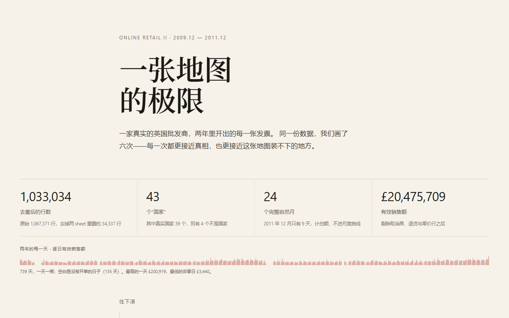
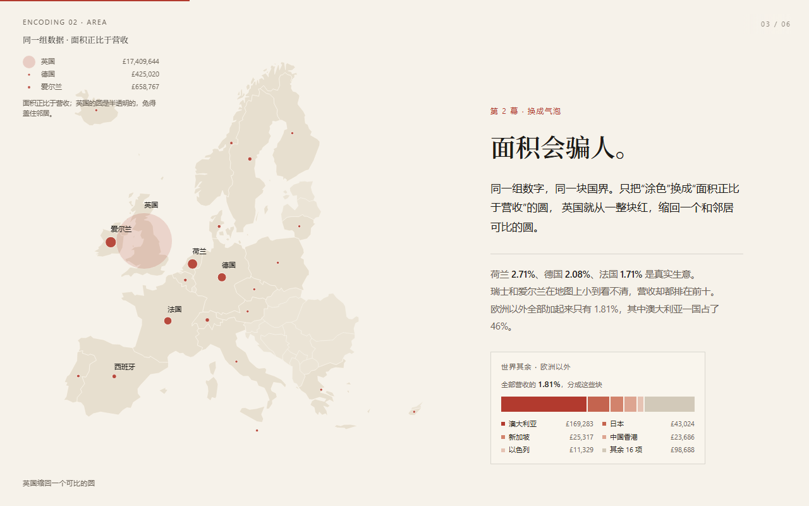
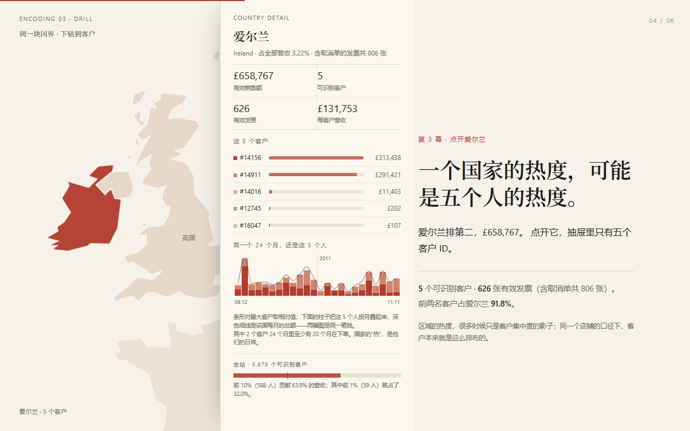
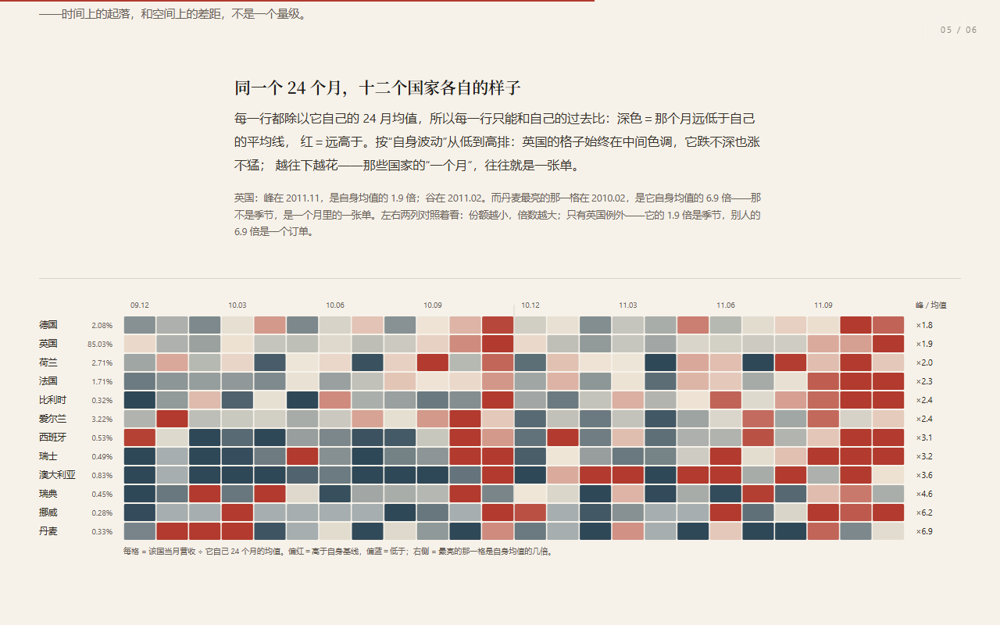
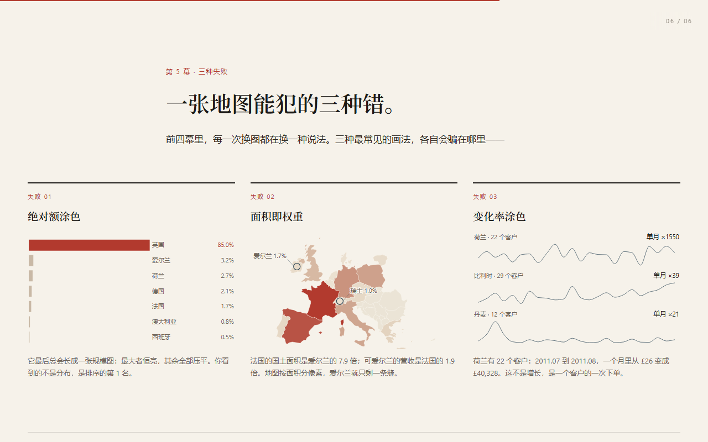

# 一张地图的极限

> 同一份英国批发商两年的发票数据，被画了六次。每一次换图都更接近真相，也更接近这张地图装不下的地方。

一件单页滚动的数据叙事作品。纯静态：没有构建工具、没有框架、没有服务器，也不发任何外部请求——断网双击 `index.html` 就能完整浏览。



## 六幕

| 幕 | 标题 | 在做什么 |
|---|---|---|
| 0 | — | 四个数字：1,033,034 行 / 43 个「国家」/ 24 个完整自然月 / £20,475,709 有效销售额；下方是 739 天的逐日纹理 |
| 1 | 看起来，我们只卖给了一个国家。 | 欧洲 22 国按营收着色，英国 85.03% 独占红色，其余近灰 |
| 2 | 面积会骗人。 | 同一块国界不动，把「涂色」换成「面积正比于营收」的圆 |
| 3 | 一个国家的热度，可能是五个人的热度。 | 点开爱尔兰：£658,767、5 个客户、626 张有效发票；抽屉里列出这 5 个客户与他们的 24 个月 |
| 4 | 季节的波动，比国家之间的差异大一个量级。 | 24 个月折线（峰 2011-11，谷 2011-02，相差 2.88×），再下钻成 12 国 × 24 月的「自身基线」热力图 |
| 5 | 一张地图能犯的三种错。 | 三种失败画法各配一张反例图，然后换一个问题：自身基线 + 置信度 + 可下钻 |
| 5.5 | 四个必须先说清楚的前提。 | 被排除的部分：取消单、负数量行、匿名订单、尾部 31 个取值 |






## 数据

- **来源**：[UCI Machine Learning Repository — Online Retail II](https://archive.ics.uci.edu/dataset/502/online+retail+ii)，一家英国注册的礼品批发商，2009-12-01 至 2011-12-09。
- **原始规模**：1,067,371 行，分两个年度 sheet；两份在 2010-12-01 至 09 重叠 9 天。
- **去重**：按 `Invoice + StockCode + Quantity + InvoiceDate + Price` 去重，删 34,337 行，余 **1,033,034 行**。
- **口径**：营收 = 非取消单、非退货、价格大于 0 的 `Quantity × Price`；发票数 = 同一口径下的唯一 `Invoice`；客户数只含填了 `Customer ID` 的行。
- **底图**：[Natural Earth](https://www.naturalearthdata.com/) 1:50m Admin 0（公共领域），未使用 GADM。

所有写进正文的数字都由 `build_data.py` 生成并写入 [`data/facts.md`](data/facts.md)；页面从 `data/data.js` 读取，正文不手写数值。

## 运行

**看**：双击 `index.html`。需要连同 `assets/` 和 `data/` 一起，`file://` 下可用。

**重跑数据**（需要 pandas + openpyxl）：

```bash
python build_data.py
```

会重写 `data/{countries,monthly,skus,concentration,daily}.json`、`data/data.js`、`data/facts.md`。

**重新截图**（Edge headless + CDP，Node 22）：

```bash
node tools/shots.mjs
```

输出 1280×800 / 1440×900 各 13 个位置到 `shots/`，并写 `shots/report.json`（含滚动宽度、溢出元素、`data-fact` 占位符快照）。

**重建底图**（可选，产物已在 `data/europe.topo.json`）：

```bash
npm i topojson-server topojson-client topojson-simplify d3-geo
node tools/build_topo.mjs ne_50m_admin_0_countries.geojson data/europe.topo.json
```

原始 GeoJSON 未入库，按上面的链接自行下载。

## 目录

```
index.html          单页叙事（六幕）
build_data.py       清洗、去重、聚合 → data/*.json + data/facts.md + data/data.js
data/
  facts.md          所有正文数字的唯一来源，含与设计稿的差异对照
  data.js           window.__DATA__ = {...}，供页面直接读取
  europe.topo.json  欧洲 22 国 + 26 个 context（25 KB）
  countries.json    43 个取值 × 营收/发票/客户/月度/前 5 客户
  monthly.json      24 个月 × 营收/订单/退货/客户
  daily.json        739 天逐日营收
  skus.json         Top 30 SKU
  concentration.json 客户集中度（洛伦兹曲线、基尼、前 10%/1%）
assets/             D3 v7.9.2、topojson-client 3.1.0（本地引入）
tools/              build_topo.mjs / shots.mjs / probe.mjs
shots/              26 张定屏截图（可当分镜用）
video-brief.md      给视频剪辑流水线的功能清单
```

## 两处设计决定

1. **气泡面积正比于营收**（半径 √营收），而不是常用的 log 半径。原因是：log 会把英国与荷兰之间 1:26 的差距画成 1:2，而那正是这件作品要指出的那类骗法。
2. **数据用 `<script>` 注入而不是 `fetch`**。`file://` 协议下 `fetch` 会被 CORS 拦掉，双击打不开——而「双击就能看」是这件作品的前提之一。

## 许可

- 代码：[MIT](LICENSE)
- 本仓库的衍生数据（`data/` 下的聚合结果）：CC BY 4.0，署名同上，并请保留 UCI 数据集的出处
- 原始数据：UCI Online Retail II，CC BY 4.0
- 底图：Natural Earth，公共领域
- D3.js（BSD-3-Clause）与 topojson-client（ISC）均以未修改的构建文件引入
